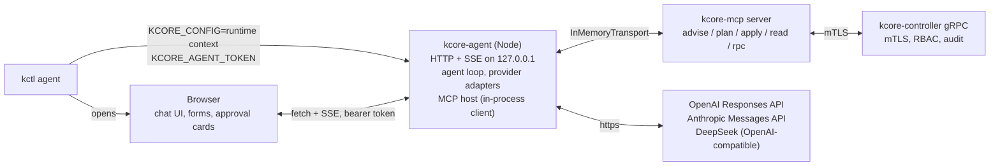

# `kctl agent`: a local chat UI that drives kcore through the MCP

Status: **built**. `kctl agent` and `kcore-mcp/packages/agent` run end to end against a model endpoint. Sign in with ChatGPT, the Anthropic adapter, OpenCode Console and Go as providers with key import from OpenCode, cluster-filled pick lists, the MCP Apps host, `--role`, session reload, npm metadata and the Nix package are in. Two things are not tested against live services: the ChatGPT sign-in (it follows OpenAI's published flow and is covered with a fake token endpoint) and a real model driving a full VM create. Release tarballs do not ship `kcore-agent` yet. See [What is built](#what-is-built).

The working tree for this work is `/mnt/data/dev/kcore/kcore-rust-agent-ui`, branched from `cursor/ceph-p0-safety-64a3` at `5d2caa8`.

## What “done” means

An operator runs `kctl agent`. A browser tab opens on `http://127.0.0.1:<port>/?token=…`. The page is a chat, in the shape of the OpenCode web UI: sessions on the left, the conversation in the middle, tool calls shown as cards. The operator picks a model (ChatGPT plan, OpenAI key, Claude key, DeepSeek key, OpenCode) and types “create a VM for the build runner”. The model calls the existing `kcore_advise` / `kcore_plan` / `kcore_apply` tools from [`kcore-mcp`](../kcore-mcp/README.md). When the MCP server needs an answer it asks with `elicitation/create`; the UI renders that as a form with real inputs (pickers filled from the cluster, not free text). Nothing is applied until the operator clicks a confirm button the model cannot click. Every call reaches the controller over mTLS with a certificate `kctl` chose, so the controller audit log shows who did it.

## What is built

| Piece | State |
|---|---|
| `kctl agent` (`--port`, `--no-browser`, `--agent-bin`, `--provisioning`, plus the global `-c`, `-s`, `-k`, `--tls-server-name`, `--as`) | Done. Writes a 0600 one-context file in a 0700 runtime directory, passes it and a 256-bit token to the agent, prints the URL, stops the agent on Ctrl-C and removes the directory. |
| Agent HTTP server, session loop, SSE | Done. Loopback only; bearer token on every `/api` call; Host and Origin checks against DNS rebinding; CSP with no inline script or style. |
| In-process MCP client with elicitation | Done. One `kcore-mcp` server instance per session over `InMemoryTransport`. |
| Approval gate | Done, see [Approval](#approval). |
| Elicitation forms | Done. `Question`s carry a type (`integer`, `number`), a minimum, and pick lists. The server fills the pick lists from the cluster, see [Forms](#forms). The UI shows labelled options (`enumNames`, `oneOf`) and number fields. |
| Providers | OpenAI API key, Anthropic API key, DeepSeek API key, OpenCode Console (pay as you go), OpenCode Go (subscription), and Sign in with ChatGPT. OpenAI, DeepSeek and OpenCode use Chat Completions streaming; Anthropic uses the Messages API; ChatGPT uses the Responses API. `OPENAI_BASE_URL`, `ANTHROPIC_BASE_URL`, `DEEPSEEK_BASE_URL`, `OPENCODE_BASE_URL` and `OPENCODE_GO_BASE_URL` redirect them. Keys live in `~/.kcore/agent/auth.json` (0600) or in `OPENAI_API_KEY` / `ANTHROPIC_API_KEY` / `DEEPSEEK_API_KEY` / `OPENCODE_API_KEY` / `OPENCODE_GO_API_KEY`. Each key row links to the page that creates a key. If `~/.local/share/opencode/auth.json` exists, the drawer offers to import its plain API keys (never account logins, never over keys already stored). |
| Sign in with ChatGPT | Built to OpenAI's open-source flow: dynamic registration, PKCE S256, `state` and `nonce`, ID token checked against OpenAI's JWKS, `chatgpt.tokens.use.direct` required, 0600 credential file written atomically, refresh three minutes before expiry with refreshes serialized, revocation on sign out. Tested against a fake token endpoint only. See [Providers](#providers). |
| Transcripts | Each session is a jsonl file under `~/.kcore/agent/sessions/`. After a restart the agent loads them: events, title, and the model's message history. A turn or form the old process left open is closed, and a tool call with no result gets a note that its outcome is unknown. |
| MCP Apps | `kcore_plan` points at `ui://kcore/plan`. The agent is an Apps host: it serves the view in a sandboxed iframe with no network and forwards only read-only tool calls. See [Layer 3](#layer-3-mcp-apps). |
| `kctl agent --role` | `read-only` or `vm-admin`. Creates `agent-<login>`, grants the role, issues a certificate if there is none, and runs as it. Refuses an operator that already holds a stronger role. |
| Packaging | `kcore-agent` has npm metadata and `npm pack` works; the bundle carries the UI and the proto files. `flake.nix` has `kcore-agent` and `kctl-with-agent`. `kctl` also finds `kcore-agent` on `PATH`. |
| `kcore-mcp` change | Elicitation requests now wait up to 30 minutes for an answer. The SDK default is 60 seconds, which cut a human off mid-form. |

Run it from a checkout:

```bash
cd kcore-mcp && npm install && npm run build
kctl agent
```

`kctl` finds the agent next to its own binary, then on `PATH` (so `npm install -g kcore-agent` works), then in `kcore-mcp/packages/agent/dist/index.js` above the binary or the working directory. `--agent-bin` or `KCORE_AGENT_BIN` override that.

To run as a limited identity without setting one up by hand:

```bash
kctl agent --role vm-admin
```

That needs a cluster-admin connection and mTLS on the first run.

## Why this shape

`kcore-mcp` already does the hard part: it knows the resource kinds, what is mutable, which questions must be answered before a change, and it refuses to plan or apply while a question is open. Today it only runs inside Cursor, VS Code, Claude Desktop and similar hosts. Those hosts decide how questions look (a flat dialog at best) and which model answers. `kctl agent` is our own MCP host: same server, our forms, the operator's choice of model, and the operator's cluster credentials handled by `kctl`.

Decisions this plan makes:

| Decision | Choice | Why |
|---|---|---|
| Where the agent runs | A Node process, `packages/agent` in the `kcore-mcp` workspace, started by `kctl agent` | `kcore-mcp` is TypeScript, the MCP SDK, elicitation and MCP Apps host SDK are TypeScript-first. The MCP server is imported in-process over `InMemoryTransport`, so there is no second process and no stdio hop. Node ≥ 20 is already a requirement of `kcore-mcp`. |
| What `kctl agent` does | Resolves the context, writes a short-lived context file, spawns the agent, opens the browser, cleans up | `kctl` already owns `~/.kcore/config`, `--as`, `--controller`, `--tls-server-name`. The agent reads one standard context file and never reimplements that logic. |
| Model access | OpenAI: Sign in with ChatGPT (open-source flow) or API key. Anthropic: API key only. DeepSeek: API key only. | See [Providers](#providers). Claude.ai login in third-party apps is forbidden by Anthropic; DeepSeek has no consumer OAuth. |
| Forms | Three layers: elicitation forms, host-native catalog forms, MCP Apps | Elicitation works today with no server change. Catalog forms give contextual pickers. MCP Apps make the same forms render in other hosts later. |
| Approval | The host, not the model, decides `confirm` | A prompt-injected model must not be able to apply. The gate lives in the agent loop and the UI. |

Rejected for now: a pure Rust agent inside `kctl` (`rmcp` client, three LLM clients, embedded assets). It would avoid Node but duplicate `kcore-mcp` logic or still spawn it. Revisit if Node on the operator workstation becomes a problem.

## Pieces



### `kctl agent` (Rust, `crates/kctl/src/commands/agent.rs`)

```
kctl agent [--port N] [--no-browser] [--as OPERATOR] [--role read-only|vm-admin]
           [--agent-bin PATH] [--provisioning host:port]
```

1. Resolve the connection with `resolve_controller` (`crates/kctl/src/config.rs`), so `-c`, `-s`, `-k`, `--tls-server-name`, `--as` behave as they do for every other command.
2. Write a one-context file under `$XDG_RUNTIME_DIR/kcore-agent/<pid>/config` (mode 0600, directory 0700) with inline `ca-data` / `cert-data` / `key-data`, `tls-server-name`, `controllers`, and `provisioning`. The agent reads it through the existing `resolveConnection` in `kcore-mcp/packages/server/src/connection.ts`. Nothing new to parse on either side.
3. Generate a 32-byte session token. Pass `KCORE_CONFIG`, `KCORE_AGENT_TOKEN` and `KCORE_AGENT_PORT` to the child. The agent keeps its own state under `KCORE_AGENT_HOME` (default `~/.kcore/agent`).
4. Spawn the agent. Resolution order for the binary: `--agent-bin`, `$KCORE_AGENT_BIN`, `kcore-agent` next to the `kctl` binary (release tarballs and the Nix package put it there), then `kcore-mcp/packages/agent/dist/index.js` above the binary or the working directory. An npm fallback comes with publishing. Fail fast with what it tried.
5. Wait for the child to print `listening http://127.0.0.1:<port>` on stdout, open the browser on `/#token=<token>` unless `--no-browser`, then forward signals and wait. The token sits in the URL fragment so it never reaches a server log or a `Referer` header; the page moves it to `sessionStorage` and clears the address bar.
6. On exit, remove the runtime directory. On `SIGINT`, stop the child first.

Which certificate the agent gets:

- Default: the current context's identity, the same one `kctl` would use. Simplest, and already what `kcore-mcp` does.
- `--as <operator>`: a per-operator certificate from `~/.kcore/operators/<name>/`, set up with `kctl operator create`, `kctl operator grant-role`, and `kctl operator issue-cert`. The controller enforces the operator's roles and the audit log names the operator. This is the recommended way to run the agent: give it `vm-admin`, keep `cluster-admin` for humans.
- `--role`: convenience that creates `agent-<local user>` with that role and issues its cert if it does not exist, then behaves like `--as agent-<local user>`. Needs the caller to be cluster admin the first time. Out of scope for the first slice.

The private key never reaches the browser. The browser talks to the agent on loopback with the session token; the agent talks to the controller.

### `kcore-agent` (TypeScript, `kcore-mcp/packages/agent`)

Server: `node:http`, bound to `127.0.0.1` only. Every `/api` request carries `Authorization: Bearer <KCORE_AGENT_TOKEN>` (the UI reads it once from the URL fragment and stores it in `sessionStorage`). `Origin` must be the agent's own origin. No CORS, no cookies.

Routes:

| Route | Role |
|---|---|
| `GET /` and `/assets/*` | The built UI |
| `GET /api/providers` | Which providers are configured, which models they offer |
| `POST /api/providers/chatgpt/signin` | Start Sign in with ChatGPT; returns the URL to open. `DELETE` signs out and revokes the refresh token |
| `GET /auth/callback` | The loopback return from OpenAI. No bearer token, because a browser redirect cannot carry one; the one-time `state` is the check |
| `POST /api/providers/:id/key` | Store an API key |
| `GET/POST /api/sessions`, `GET /api/sessions/:id` | Session list and transcript |
| `POST /api/sessions/:id/messages` | Send a user turn |
| `GET /api/sessions/:id/events` | SSE: tokens, tool calls, tool results, form requests, approval requests |
| `POST /api/sessions/:id/forms/:formId` | Submit or cancel a form |
| `POST /api/sessions/:id/approvals/:approvalId` | Approve or reject a mutation |
| `POST /api/sessions/:id/apps`, `GET /apps/:key` | Fetch an MCP App view a tool of this session offers, and serve it sandboxed |
| `POST /api/sessions/:id/call` | A tool call made by an app view. Read-only tools only |
| `GET /api/cluster/summary` | Context name, controller, operator CN (from the certificate), node count, for the header |

Agent loop, one implementation for all providers:

1. Build the tool list from `client.listTools()` on the in-process MCP client, plus two host tools: `kcore_form` (model asks the operator for structured data, see [Forms](#forms)) and `kcore_catalog_form` (model asks for a prebuilt form for a resource kind).
2. Stream the model. Provider adapters normalize to one event type: `text`, `tool_call`, `done`, `usage`.
3. For each `tool_call`:
   - `kcore_apply`, `kcore_delete`, `kcore_operation`, and `kcore_rpc` with a mutating method: strip `confirm` from the arguments, show an approval card with the planned call (the plan output when there is one), block until the operator answers. Approved: call with `confirm: true`. Rejected: return a tool result saying so and let the model continue.
   - Everything else: call directly.
4. The MCP client declares the `elicitation` capability. When the server sends `elicitation/create`, the loop emits a `form` event with the `requestedSchema`, blocks on the submission, and answers `accept` / `decline` / `cancel`.
5. Append every turn, tool call, form, and approval to `~/.kcore/agent/sessions/<id>.jsonl`. Redact with the existing `redact` from `kcore-mcp/packages/server/src/grpc.ts` before writing tool results.

The approval gate is independent of `kcore-mcp`'s own `confirm` check and of the model's instructions. Both stay. The system prompt is the `INSTRUCTIONS` string from `server.ts` plus the `kcore-operator` skill.

Provider adapters: start with the Vercel AI SDK (`ai`, `@ai-sdk/openai`, `@ai-sdk/anthropic`, `@ai-sdk/deepseek`) for the streaming and tool-call loop. If the ChatGPT plan token does not fit its OpenAI adapter (the plan flow needs the Responses API with `store: false`, `stream: true`, and a bearer token on `https://api.openai.com/v1`), write that one adapter on the `openai` SDK directly. Decide in the first spike.

### Approval

Three tools change the cluster themselves and already ask the operator through `elicitation/create` when `confirm` is not true: `kcore_apply`, `kcore_delete`, `kcore_operation`. The host uses that instead of adding a second prompt:

- The model never sees a `confirm` argument. The host sends `confirm: false` on those three tools whatever the model wrote, so the server's own yes/no elicitation fires and the UI shows it as an approval card with Approve and Reject.
- `kcore_rpc` with a method that is not a get, list, classify, check, or plan, and `kcore_operation` with `install-node`, do not ask on the server side (or ask only after the model has typed the acknowledgement phrase). For those the host shows its own approval card with the exact request, and sets `confirm: true` only after Approve. The `acknowledge` phrase is hidden from that card; the operator reads the device list and approves.
- Reject, Skip, Stop, and closing the tab all end up as "not approved". The tool result tells the model nothing changed.
- The model also cannot choose where the call goes. `connection` is reduced to `node`; controller, TLS, config path and operator come from the context `kctl agent` wrote.

Answers from a form come back to the model in the tool result as `Operator form answers`, because the server merges them into its own copy of the spec and does not echo them.

### UI (`kcore-mcp/packages/agent/ui`, plain HTML, CSS and JS for now)

Layout copied from the OpenCode web client:

- Left: sessions, new session, cluster context badge (context name, controller, operator CN).
- Centre: transcript. Tool calls render as collapsible cards: name, arguments, result, duration. `kcore_plan` output renders as a diff. `kcore_advise` output renders its blocking and recommended questions as a form straight away, so the operator does not wait for the model to ask one by one.
- Composer at the bottom, model picker next to it.
- Right drawer: provider connections. “Sign in with ChatGPT”, “OpenAI API key”, “Anthropic API key”, “DeepSeek API key”. Shows the signed-in ChatGPT account and lets the operator sign out.
- Forms and approvals appear inline in the transcript and also pin to the top while pending. A pending approval blocks the composer.

No marketing surface. Dashboard CSS (`crates/dashboard/assets/dashboard.css`) is the starting point for tokens and dark mode so the two web surfaces match.

## Providers

| Provider | Auth | Endpoint | Notes |
|---|---|---|---|
| OpenAI, ChatGPT plan | Sign in with ChatGPT, open-source flow | Responses API, `https://api.openai.com/v1` | PKCE S256. First sign-in uses `client_id=dynamic_agent_client`, `agent_name_hint=kcore`, a persistent `ext_agent_host_id` per machine. The callback must be a loopback URL on `127.0.0.1`, same path every time, port may vary: `http://127.0.0.1:<port>/auth/callback`. The issued `client_id` is saved per ChatGPT account and reused. Scopes: `openid profile email offline_access resource.invoke chatgpt.tokens.use.direct`; refuse to use the token for inference unless `chatgpt.tokens.use.direct` was granted. Requests set `store: false`, `stream: true`, send the whole history in `input`, put the system prompt in `instructions`, and group the tools in one `kcore` namespace; replayed `function_call` items carry the namespace. Fields the plan route rejects (`temperature`, `max_output_tokens`, `previous_response_id` and the rest) are never sent. A 401 triggers one refresh and retry. `subscription_sharing_usage_limit_exceeded` is shown as a usage-limit message. Plan usage needs a Go/Plus/Pro plan; the help page lists OpenCode as an approved integration, and the open-source flow is self-service. |
| OpenAI, API key | Key | Chat Completions (built) | Fallback for Team/Enterprise accounts and CI. |
| Anthropic | API key only | Messages API (built) | Anthropic's Claude Code legal page says third-party apps may not offer Claude.ai login or route requests through Free/Pro/Max credentials, and enforces it server-side (OpenCode removed its Anthropic OAuth plugin in 1.3.0, March 2026). Offer Console API key, and Bedrock / Vertex through the SDK's provider options. Do not ship a Claude subscription login. |
| DeepSeek | API key only | `https://api.deepseek.com`, OpenAI-compatible | `deepseek-chat` supports function calling. Check `deepseek-reasoner` tool support before listing it. |
| OpenCode Console | API key (`https://opencode.ai/auth`) | `https://opencode.ai/inference/openai/v1/chat/completions`, models at `/inference/v1/models` | One key reaches Claude, GPT, DeepSeek, Gemini, Kimi and others; Console translates between APIs. This is the supported way to use Claude without a Claude Console account. Free-tier models are restricted to OpenCode itself. Built from OpenCode's published docs; not run against a live key. |
| OpenCode Go | API key from a workspace with Go | `https://opencode.ai/inference/go/openai/v1/chat/completions` | Subscription plan with open models. The model-list URL (`/inference/go/v1/models`) is inferred; the default model is the fallback if it does not answer. |

Credential storage: `~/.kcore/agent/auth.json`, mode 0600, same shape as OpenCode's `auth.json` (`{ provider: { type: "oauth" | "api", ... } }`). Refresh tokens stay in that file; the browser never sees them. The agent sends only `{ provider, account, expiresAt }` to the UI.

The OpenAI sign-in runs on the agent's own HTTP server, not a separate listener, because the callback must be a loopback address and the agent already owns one. `kctl agent --port` therefore also fixes the callback port; the first sign-in and later sign-ins may use different ports, which the open-source flow allows as long as scheme, host and path stay the same.

## Forms

The point of forms is to stop the model from guessing image URLs, checksums, network names and SSH keys out of free text, and to stop the operator from typing them wrong.

### Pick lists from the cluster (built)

The first plan put the lookups in the agent (a host tool, `kcore_catalog_form`, and `_meta.kcore.source` hints the host resolved). That was dropped. The lookup now happens in `kcore-mcp`, in the same place it builds the `elicitation/create` schema, so every MCP host gets the lists, not just this one.

- Each `Question` can name a `source`: `networks`, `ssh-keys`, `nodes`, `vms` or `node-images`. A question marked `restrict` becomes an enum: the VM `network`, the container `network`, the PostgreSQL `targetNode`, the volume `vm`, the disk-layout `nodeId`. Options carry labels (`enumNames`), for example a node shows as `node-103 (host-a, ready)`.
- A source without `restrict` keeps a free-text field and lists what exists in the explanation: the VM `auth` field lists stored SSH key names (a pasted public key still works), the VM `image` field lists images on the nodes, `placement` lists nodes.
- `type: "integer"` and `min` come through as a number field with a minimum (`cpu`, `keep`).
- If the controller cannot be read, or the list is empty, the question stays as it was and says so. Each source is read once per ask, with an 8 second limit.

What was not built: forms for `ceph-cluster` members and node disks, and `cluster-update` windows. They still use text fields.

### Layer 3: MCP Apps

MCP Apps is the `io.modelcontextprotocol/ui` extension (spec `2026-01-26`): a tool points at a `ui://` resource through `_meta.ui.resourceUri`, the host renders that HTML in a sandboxed iframe, and the iframe talks to the host over JSON-RPC `postMessage`.

Built:

- `kcore-mcp` serves `ui://kcore/plan` (`text/html;profile=mcp-app`) and `kcore_plan` points at it. The view shows the action (create, update, replace, unchanged), the field changes with immutable ones marked, the spec for a create, warnings, the controller calls, and the cluster state. Fields that look like secrets are masked. Hosts that do not know Apps ignore it and still get the JSON.
- The agent is a host for it. After a tool result, if the tool names a view, the agent fetches it and shows it under the tool card. It answers `ui/initialize`, sends `tool-input` and `tool-result`, resizes the frame on `size-changed`, and handles `tools/call`, `ui/open-link` (https only, with a confirm), and `ping`.
- The frame is `sandbox="allow-scripts"` with no `allow-same-origin`, so it has an opaque origin and cannot read the page or its token. Its own response carries `default-src 'none'; script-src 'unsafe-inline'; style-src 'unsafe-inline'; sandbox allow-scripts`: no network, no frames, no storage. The URL is a random 48-hex key that the authenticated API hands out and that expires after an hour. The `csp` and `permissions` a resource declares in `_meta.ui` are ignored, so a view can never be given network access.
- A view's `tools/call` goes through the host and is limited to `kcore_advise`, `kcore_plan`, `kcore_read` and `kcore_catalog`, with `connection` removed. Apply, delete, operation and `kcore_rpc` are refused, so a view cannot approve or change anything.

Not built: form views (`ui://kcore/<kind>-form`). The schema forms cover that path, and app-rendered elicitation is still a draft tied to protocol revision `2026-07-28`, so nothing depends on it. The host also does not use `@modelcontextprotocol/ext-apps`; it implements the handful of messages above directly, and it has been tried in a browser against the `kcore` plan view only, not in ChatGPT, Claude or Cursor.

## Security

- Loopback only. Bind `127.0.0.1`, refuse `KCORE_AGENT_BIND` values that are not loopback unless `--unsafe-bind` is also set, and document that remote use goes through an SSH tunnel.
- Session token in every request. The token is 256 bits, printed once by `kctl`, and rotates per run.
- The browser never holds cluster certificates, provider refresh tokens, or the agent's `auth.json`.
- Human approval for every mutation, enforced in the loop, with the exact arguments displayed. The model cannot set `confirm`.
- Tool results are data. The system prompt says so, and node-install (`spec.acknowledge: wipe the selected disks`) stays a typed phrase in a form field, never prefilled.
- `kcore-mcp`'s `redact` runs on everything written to disk or sent to the UI, so `key-data`, cloud-init secrets and tokens do not land in transcripts.
- Provider calls leave the machine. The header shows which provider a session uses, and `kctl agent --offline` refuses to start a session without a configured local or self-hosted endpoint (future: an OpenAI-compatible `baseUrl` provider for vLLM or Ollama, which is one more row in the providers table).
- With `--as`, controller RBAC limits what the agent can do regardless of the model. Read-only operators get a read-only agent.

## Distribution

- `kcore-mcp/packages/agent` is `kcore-agent`: bundled with esbuild into one `dist/index.js`, with the UI in `dist/ui` and the proto files in `dist/proto`. Everything is bundled, so it has no runtime dependencies. `npm pack -w kcore-agent` builds and packs it. Publishing is not done.
- `flake.nix`: `packages.kcore-agent` (`buildNpmPackage` from `kcore-mcp/package-lock.json`) and `packages.kctl-with-agent`, a `kctl` wrapper that sets `KCORE_AGENT_BIN`. Update `npmDepsHash` when the lock file changes (`nix run nixpkgs#prefetch-npm-deps -- kcore-mcp/package-lock.json`).
- `kctl agent` looks next to `kctl`, then on `PATH`.
- Not done: release tarballs do not ship `kcore-agent`. `scripts/release.sh`, `get-kctl.sh` and `verify-release.sh` handle signed, checksummed `kctl` archives, and adding an asset means changing that chain, so it is left for a release.

## Phases

1. **Spike** (built): `packages/agent` with an in-process MCP client, SSE chat, elicitation rendered as a schema form, approval gate. `kctl agent` with context handoff and browser open. Still to do: create a VM in the lab end to end with a real model.
2. **Providers** (built): Sign in with ChatGPT, Anthropic key, DeepSeek key, OpenAI key, `auth.json`, model picker. The ChatGPT flow is untested against OpenAI. No usage display yet beyond the link to ChatGPT Settings.
3. **Forms** (mostly built): typed questions and cluster pick lists in `kcore-mcp`. Not built: Ceph member and disk pickers, advise questions as one form.
4. **Operator identity** (partly built): `--role` and auto-provisioning. Not built: an audit view in the UI.
5. **MCP Apps** (partly built): the plan view and the host. Not built: form views, and checking it in other Apps hosts.
6. **Packaging** (partly built): npm metadata, Nix packages, `PATH` lookup. Not built: release tarballs, publishing, docs on `kcorehypervisor.com`.

## Open questions

- Should `kctl agent` default to the current context identity or refuse to run as `kctl` (cluster admin) without `--as`? Refusing is safer; defaulting is friendlier for a single-operator lab. Proposal: default to the context identity, print a one-line warning when the certificate CN is `kctl`.
- Does the Sign in with ChatGPT open-source flow accept `agent_name_hint=kcore` without prior registration? The docs say registration is dynamic; the code follows them, but nobody has signed in with it yet. Try it with a Plus or Pro account before relying on it. The credential file is not locked across processes, so two `kctl agent` runs on one machine can race a rotating refresh token.
- One agent per `kctl agent` run, or a long-lived agent the dashboard can embed? This plan is the per-run tool. Embedding in the dashboard needs a different credential story (dashboard identity, not operator identity) and is not covered here.
- Vercel AI SDK versus direct provider SDKs. Phase 1 uses plain `fetch` against Chat Completions, which covers OpenAI keys, DeepSeek, and any OpenAI-compatible server. Anthropic and the ChatGPT plan flow (Responses API) have their own adapters, also on plain `fetch`.

## Related

- [`kcore-mcp/README.md`](../kcore-mcp/README.md): the tools the agent calls.
- [mtls-bootstrap-and-auth.md](./mtls-bootstrap-and-auth.md): contexts, operator certificates, RBAC.
- [kctl-commands-and-workflows.md](./kctl-commands-and-workflows.md): the verbs the model will end up calling.
- [security.md](./security.md): threat model the approval gate and loopback rules follow.
