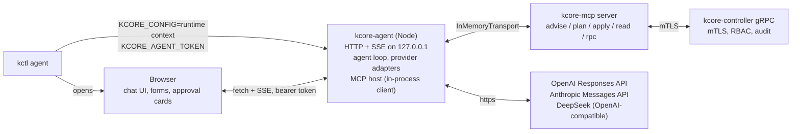

# `kctl agent`: a local chat UI that drives kcore through the MCP

Status: **plan**. No package, command, or UI yet.

The working tree for this work is `/mnt/data/dev/kcore/kcore-rust-agent-ui`, branched from `cursor/ceph-p0-safety-64a3` at `5d2caa8`.

## What “done” means

An operator runs `kctl agent`. A browser tab opens on `http://127.0.0.1:<port>/?token=…`. The page is a chat, in the shape of the OpenCode web UI: sessions on the left, the conversation in the middle, tool calls shown as cards. The operator picks a model (ChatGPT plan, OpenAI key, Anthropic key, DeepSeek key) and types “create a VM for the build runner”. The model calls the existing `kcore_advise` / `kcore_plan` / `kcore_apply` tools from [`kcore-mcp`](../kcore-mcp/README.md). When the MCP server needs an answer it asks with `elicitation/create`; the UI renders that as a form with real inputs (pickers filled from the cluster, not free text). Nothing is applied until the operator clicks a confirm button the model cannot click. Every call reaches the controller over mTLS with a certificate `kctl` chose, so the controller audit log shows who did it.

## Why this shape

`kcore-mcp` already does the hard part: it knows the resource kinds, what is mutable, which questions must be answered before a change, and it refuses to plan or apply while a question is open. Today it only runs inside Cursor, VS Code, Claude Desktop and similar hosts. Those hosts decide how questions look (a flat dialog at best) and which model answers. `kctl agent` is our own MCP host: same server, our forms, the operator's choice of model, and the operator's cluster credentials handled by `kctl`.

Decisions this plan makes:

| Decision | Choice | Why |
|---|---|---|
| Where the agent runs | A Node process, `packages/agent` in the `kcore-mcp` workspace, started by `kctl agent` | `kcore-mcp` is TypeScript, the MCP SDK, elicitation and MCP Apps host SDK are TypeScript-first. The MCP server is imported in-process over `InMemoryTransport`, so there is no second process and no stdio hop. Node ≥ 20 is already a requirement of `kcore-mcp`. |
| What `kctl agent` does | Resolves the context, writes a short-lived context file, spawns the agent, opens the browser, cleans up | `kctl` already owns `~/.kcore/config`, `--as`, `--controller`, `--tls-server-name`. The agent reads one standard context file and never reimplements that logic. |
| Model access | OpenAI: Sign in with ChatGPT (open-source flow) or API key. Anthropic: API key only. DeepSeek: API key only. | See [Providers](#providers). Claude.ai login in third-party apps is forbidden by Anthropic; DeepSeek has no consumer OAuth. |
| Forms | Three layers: elicitation forms, host-native catalog forms, MCP Apps | Elicitation works today with no server change. Catalog forms give contextual pickers. MCP Apps make the same forms render in other hosts later. |
| Approval | The host, not the model, sets `confirm: true` | A prompt-injected model must not be able to apply. The gate lives in the agent loop and the UI. |

Rejected for now: a pure Rust agent inside `kctl` (`rmcp` client, three LLM clients, embedded assets). It would avoid Node but duplicate `kcore-mcp` logic or still spawn it. Revisit if Node on the operator workstation becomes a problem.

## Pieces



### `kctl agent` (Rust, `crates/kctl/src/commands/agent.rs`)

```
kctl agent [--port N] [--no-browser] [--as OPERATOR] [--role read-only|vm-admin]
           [--agent-bin PATH] [--provisioning host:port]
```

1. Resolve the connection with `resolve_controller` (`crates/kctl/src/config.rs`), so `-c`, `-s`, `-k`, `--tls-server-name`, `--as` behave as they do for every other command.
2. Write a one-context file under `$XDG_RUNTIME_DIR/kcore-agent/<pid>/config` (mode 0600, directory 0700) with inline `ca-data` / `cert-data` / `key-data`, `tls-server-name`, `controllers`, and `provisioning`. The agent reads it through the existing `resolveConnection` in `kcore-mcp/packages/server/src/connection.ts`. Nothing new to parse on either side.
3. Generate a 32-byte session token. Pass `KCORE_CONFIG`, `KCORE_AGENT_TOKEN`, `KCORE_AGENT_PORT`, `KCORE_AGENT_HOME=~/.kcore/agent` to the child.
4. Spawn the agent. Resolution order for the binary: `--agent-bin`, `$KCORE_AGENT_BIN`, `kcore-agent` next to the `kctl` binary (release tarballs and the Nix package put it there), then `npx -y kcore-agent@<kctl version>`. Fail fast with the three paths it tried.
5. Wait for the child to print `listening http://127.0.0.1:<port>` on stdout, open the browser on `/?token=<token>` unless `--no-browser`, then forward signals and wait.
6. On exit, remove the runtime directory. On `SIGINT`, stop the child first.

Which certificate the agent gets:

- Default: the current context's identity, the same one `kctl` would use. Simplest, and already what `kcore-mcp` does.
- `--as <operator>`: a per-operator certificate from `~/.kcore/operators/<name>/`, set up with `kctl operator create`, `kctl operator grant-role`, and `kctl operator issue-cert`. The controller enforces the operator's roles and the audit log names the operator. This is the recommended way to run the agent: give it `vm-admin`, keep `cluster-admin` for humans.
- `--role`: convenience that creates `agent-<local user>` with that role and issues its cert if it does not exist, then behaves like `--as agent-<local user>`. Needs the caller to be cluster admin the first time. Out of scope for the first slice.

The private key never reaches the browser. The browser talks to the agent on loopback with the session token; the agent talks to the controller.

### `kcore-agent` (TypeScript, `kcore-mcp/packages/agent`)

Server: `node:http` or Hono, bound to `127.0.0.1` only. Every request carries `Authorization: Bearer <KCORE_AGENT_TOKEN>` (the UI reads it once from the URL and stores it in `sessionStorage`). `Origin` must be the agent's own origin. No CORS, no cookies.

Routes:

| Route | Role |
|---|---|
| `GET /` and `/assets/*` | The built UI |
| `GET /api/providers` | Which providers are configured, which models they offer |
| `POST /api/providers/openai/signin` | Start Sign in with ChatGPT; returns the URL to open |
| `POST /api/providers/:id/key` | Store an API key |
| `GET/POST /api/sessions`, `GET /api/sessions/:id` | Session list and transcript |
| `POST /api/sessions/:id/messages` | Send a user turn |
| `GET /api/sessions/:id/events` | SSE: tokens, tool calls, tool results, form requests, approval requests |
| `POST /api/sessions/:id/forms/:formId` | Submit or cancel a form |
| `POST /api/sessions/:id/approvals/:approvalId` | Approve or reject a mutation |
| `GET /api/cluster/summary` | Context name, controller, operator CN (from the certificate), node count, for the header |

Agent loop, one implementation for all providers:

1. Build the tool list from `client.listTools()` on the in-process MCP client, plus two host tools: `kcore_form` (model asks the operator for structured data, see [Forms](#forms)) and `kcore_catalog_form` (model asks for a prebuilt form for a resource kind).
2. Stream the model. Provider adapters normalize to one event type: `text`, `tool_call`, `done`, `usage`.
3. For each `tool_call`:
   - `kcore_apply`, `kcore_delete`, `kcore_operation`, and `kcore_rpc` with a mutating method: strip `confirm` from the arguments, show an approval card with the planned call (the plan output when there is one), block until the operator answers. Approved: call with `confirm: true`. Rejected: return a tool result saying so and let the model continue.
   - Everything else: call directly.
4. The MCP client declares the `elicitation` capability. When the server sends `elicitation/create`, the loop emits a `form` event with the `requestedSchema`, blocks on the submission, and answers `accept` / `decline` / `cancel`.
5. Append every turn, tool call, form, and approval to `~/.kcore/agent/sessions/<id>.jsonl`. Redact with the existing `redact` from `kcore-mcp/packages/server/src/grpc.ts` before writing tool results.

The approval gate is independent of `kcore-mcp`'s own `confirm` check and of the model's instructions. Both stay. The system prompt is the `INSTRUCTIONS` string from `server.ts` plus the `kcore-operator` skill.

Provider adapters: start with the Vercel AI SDK (`ai`, `@ai-sdk/openai`, `@ai-sdk/anthropic`, `@ai-sdk/deepseek`) for the streaming and tool-call loop. If the ChatGPT plan token does not fit its OpenAI adapter (the plan flow needs the Responses API with `store: false`, `stream: true`, and a bearer token on `https://api.openai.com/v1`), write that one adapter on the `openai` SDK directly. Decide in the first spike.

### UI (`kcore-mcp/packages/agent/ui`, Vite + Preact or React)

Layout copied from the OpenCode web client:

- Left: sessions, new session, cluster context badge (context name, controller, operator CN).
- Centre: transcript. Tool calls render as collapsible cards: name, arguments, result, duration. `kcore_plan` output renders as a diff. `kcore_advise` output renders its blocking and recommended questions as a form straight away, so the operator does not wait for the model to ask one by one.
- Composer at the bottom, model picker next to it.
- Right drawer: provider connections. “Sign in with ChatGPT”, “OpenAI API key”, “Anthropic API key”, “DeepSeek API key”. Shows the signed-in ChatGPT account and lets the operator sign out.
- Forms and approvals appear inline in the transcript and also pin to the top while pending. A pending approval blocks the composer.

No marketing surface. Dashboard CSS (`crates/dashboard/assets/dashboard.css`) is the starting point for tokens and dark mode so the two web surfaces match.

## Providers

| Provider | Auth | Endpoint | Notes |
|---|---|---|---|
| OpenAI, ChatGPT plan | Sign in with ChatGPT, open-source flow | Responses API, `https://api.openai.com/v1` | PKCE S256. First sign-in uses `client_id=dynamic_agent_client`, `agent_name_hint=kcore`, a persistent `ext_agent_host_id` per machine. The callback must be a loopback URL on `127.0.0.1`, same path every time, port may vary: `http://127.0.0.1:<port>/auth/openai/callback`. The issued `client_id` is saved per ChatGPT account and reused. Scopes: `openid profile email offline_access resource.invoke chatgpt.tokens.use.direct`; refuse to use the token for inference unless `chatgpt.tokens.use.direct` was granted. Requests set `store: false`, `stream: true`. Plan usage needs a Go/Plus/Pro plan; the help page lists OpenCode as an approved integration, and the open-source flow is self-service. |
| OpenAI, API key | Key | Responses API | Fallback for Team/Enterprise accounts and CI. |
| Anthropic | API key only | Messages API | Anthropic's Claude Code legal page says third-party apps may not offer Claude.ai login or route requests through Free/Pro/Max credentials, and enforces it server-side (OpenCode removed its Anthropic OAuth plugin in 1.3.0, March 2026). Offer Console API key, and Bedrock / Vertex through the SDK's provider options. Do not ship a Claude subscription login. |
| DeepSeek | API key only | `https://api.deepseek.com`, OpenAI-compatible | `deepseek-chat` supports function calling. Check `deepseek-reasoner` tool support before listing it. |

Credential storage: `~/.kcore/agent/auth.json`, mode 0600, same shape as OpenCode's `auth.json` (`{ provider: { type: "oauth" | "api", ... } }`). Refresh tokens stay in that file; the browser never sees them. The agent sends only `{ provider, account, expiresAt }` to the UI.

The OpenAI sign-in runs on the agent's own HTTP server, not a separate listener, because the callback must be a loopback address and the agent already owns one. `kctl agent --port` therefore also fixes the callback port; the first sign-in and later sign-ins may use different ports, which the open-source flow allows as long as scheme, host and path stay the same.

## Forms

The point of forms is to stop the model from guessing image URLs, checksums, network names and SSH keys out of free text, and to stop the operator from typing them wrong.

### Layer 1: elicitation forms (first slice)

`kcore-mcp` already sends `elicitation/create` with a JSON schema built from `Question[]` (`elicit` in `server.ts`). Today every property is a string. Two changes make these useful as forms:

- Give `Question` a `type` (`string`, `number`, `boolean`, `enum`) and a `format` (`uri`, `sha256`, `ipv4`, `cidr`, `bytes`) and emit them in `requestedSchema`. The host validates before it answers; other MCP hosts fall back to text.
- Add `source` hints in `_meta` (`{ "kcore": { "source": "networks" } }`) for questions whose answers exist in the cluster. The agent host resolves them with `kcore_read` and renders a select. Hosts that do not understand `_meta` still see an ordinary string field.

The UI renders `requestedSchema` with one component per property type. Required fields block submit. Decline returns `action: "decline"`, which the server already treats as “question still open”.

### Layer 2: host-native catalog forms (first slice)

One form definition per resource kind in `kcore_catalog`, kept in `packages/agent/src/forms/<kind>.ts`. Each field says where its options come from:

| Kind | Fields with cluster-sourced options |
|---|---|
| `vm` | `network` and `extraNetworks` from `listNetworks`; `sshKeys` from `listSshKeys`; `targetNode` from `listNodes`; `imagePath` from the node image list (`readImages` in `server.ts`); `storageBackend` from the `storage_backend` of the nodes returned by `listNodes` (what `kctl get storage-class` derives) |
| `volume` | `vm` from `listVms` filtered to stopped VMs; storage class from the same node list |
| `network` | `targetNode` |
| `ceph-cluster` | members from `listNodes`; disks from each node's disk inventory |
| `cluster-update` | nodes, maintenance window |

The model calls `kcore_catalog_form({ kind, prefill })`. The agent renders the form, prefilled from the conversation, and returns the submitted spec as the tool result. The model then calls `kcore_advise` with that spec, which is normally already `ready: true`, then `kcore_plan`, then asks for approval. Immutable fields from `KINDS` are shown read-only when the form is an update of an existing resource.

### Layer 3: MCP Apps (later)

MCP Apps is the official `io.modelcontextprotocol/ui` extension (spec `2026-01-26`): a tool points at a `ui://` resource through `_meta.ui.resourceUri`, the host renders that HTML in a sandboxed iframe, and the iframe talks to the host over JSON-RPC `postMessage`. Move the layer-2 forms and the plan diff into `ui://kcore/<kind>-form` and `ui://kcore/plan` resources served by `kcore-mcp`, and make the agent an Apps host with `@modelcontextprotocol/ext-apps`. The same forms then show up in ChatGPT, Claude and Cursor hosts that support Apps, and the agent keeps the layer-2 components as the fallback for hosts that do not.

App-rendered elicitation (an elicitation request that names a `ui://` resource) is still a draft tied to protocol revision `2026-07-28`. Do not depend on it. The layer-1 schema forms cover the blocking path until it lands.

## Security

- Loopback only. Bind `127.0.0.1`, refuse `KCORE_AGENT_BIND` values that are not loopback unless `--unsafe-bind` is also set, and document that remote use goes through an SSH tunnel.
- Session token in every request. The token is 256 bits, printed once by `kctl`, and rotates per run.
- The browser never holds cluster certificates, provider refresh tokens, or the agent's `auth.json`.
- Human approval for every mutation, enforced in the loop, with the exact arguments displayed. The model cannot set `confirm`.
- Tool results are data. The system prompt says so, and node-install (`spec.acknowledge: wipe the selected disks`) stays a typed phrase in a form field, never prefilled.
- `kcore-mcp`'s `redact` runs on everything written to disk or sent to the UI, so `key-data`, cloud-init secrets and tokens do not land in transcripts.
- Provider calls leave the machine. The header shows which provider a session uses, and `kctl agent --offline` refuses to start a session without a configured local or self-hosted endpoint (future: an OpenAI-compatible `baseUrl` provider for vLLM or Ollama, which is one more row in the providers table).
- With `--as`, controller RBAC limits what the agent can do regardless of the model. Read-only operators get a read-only agent.

## Distribution

- `kcore-mcp/packages/agent` publishes to npm as `kcore-agent`, bundled with esbuild like the server, UI built into `dist/ui`.
- `flake.nix`: a `kcore-agent` package (`buildNpmPackage`) and a `kctl` wrapper that puts it on `PATH`, so the appliance and the dev shell have it.
- Release tarballs ship `kcore-agent` next to `kctl`; `kctl agent` looks there first.
- `npx -y kcore-agent@<version>` is the fallback for a bare `kctl` binary.

## Phases

1. **Spike**: `packages/agent` with one provider (OpenAI API key), in-process MCP client, SSE chat, elicitation rendered as a schema form, approval gate. `kctl agent` with context handoff and browser open. Target: create a VM in the lab end to end with every question answered through a form.
2. **Providers**: Sign in with ChatGPT, Anthropic key, DeepSeek key, `auth.json`, model picker, usage display.
3. **Forms**: typed `Question`s and `_meta.kcore.source` in `kcore-mcp`; catalog forms with cluster-sourced pickers; plan diff card; advise questions rendered as one form.
4. **Operator identity**: `--role`, agent operator auto-provisioning, audit view in the UI (`kctl audit` data filtered by the agent's CN).
5. **MCP Apps**: `ui://` resources in `kcore-mcp`, Apps host in the agent, verify in ChatGPT and Cursor.
6. **Packaging**: npm publish, Nix package, release tarball, docs on `kcorehypervisor.com`.

## Open questions

- Should `kctl agent` default to the current context identity or refuse to run as `kctl` (cluster admin) without `--as`? Refusing is safer; defaulting is friendlier for a single-operator lab. Proposal: default to the context identity, print a one-line warning when the certificate CN is `kctl`.
- Does the Sign in with ChatGPT open-source flow accept `agent_name_hint=kcore` without prior registration? The docs say registration is dynamic; confirm in the spike before building the UI around it.
- One agent per `kctl agent` run, or a long-lived agent the dashboard can embed? This plan is the per-run tool. Embedding in the dashboard needs a different credential story (dashboard identity, not operator identity) and is not covered here.
- Vercel AI SDK versus direct provider SDKs. Decided in phase 1.

## Related

- [`kcore-mcp/README.md`](../kcore-mcp/README.md): the tools the agent calls.
- [mtls-bootstrap-and-auth.md](./mtls-bootstrap-and-auth.md): contexts, operator certificates, RBAC.
- [kctl-commands-and-workflows.md](./kctl-commands-and-workflows.md): the verbs the model will end up calling.
- [security.md](./security.md): threat model the approval gate and loopback rules follow.
